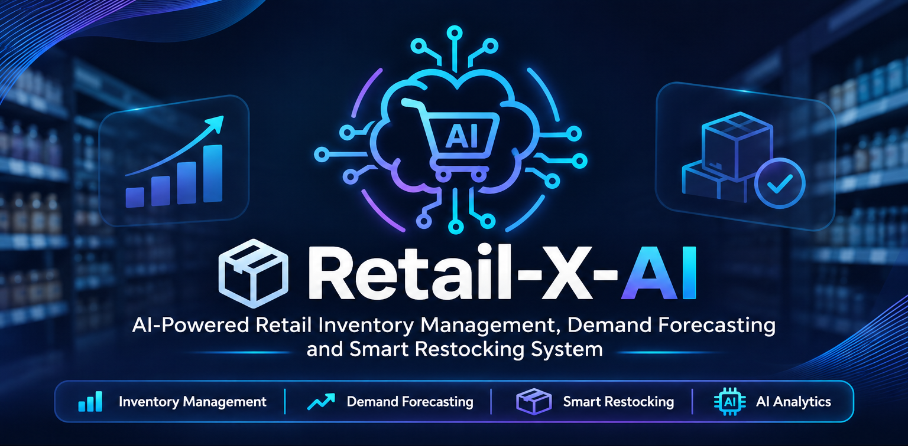

# Retail-X-AI

### AI-Powered Retail Inventory Management, Demand Forecasting and Smart Restocking System

---

## 1. Project Overview

Retail-X-AI is an intelligent retail inventory management system designed to help businesses monitor inventory levels, analyse sales performance, forecast product demand and make smarter restocking decisions.

The system combines data analytics, machine learning and an interactive dashboard to support better inventory management, reduce stockouts and improve operational efficiency.

## 2. Problem Statement

Retail businesses often experience challenges such as:

- Overstocking and unnecessary inventory costs.
- Product shortages and stockouts.
- Difficulty predicting future product demand.
- Limited visibility into sales and inventory performance.
- Manual inventory monitoring and restocking decisions.

Retail-X-AI addresses these challenges by providing an integrated platform for analysing retail data and supporting data-driven inventory decisions.

## 3. Project Objectives

The main objectives of Retail-X-AI are to:

1. Monitor inventory levels across multiple stores.
2. Analyse historical retail sales data.
3. Use AI-powered forecasting to estimate product demand.
4. Generate intelligent restocking recommendations.
5. Identify low-stock and critical inventory situations.
6. Provide an interactive dashboard for visualising business performance.
7. Offer an AI chatbot for inventory-related enquiries.

## 4. Key Features

###  Business Dashboard

- Displays total stores and products.
- Tracks units sold and estimated revenue.
- Provides daily sales trends.
- Highlights inventory alerts.
- Displays top-selling products and category performance.

###  Sales Analysis

- Analyses product sales performance.
- Provides regional sales comparisons.
- Evaluates promotional impact.
- Examines the relationship between weather conditions and sales.

###  AI Demand Forecasting

- Displays actual demand against predicted demand.
- Provides forecasting performance metrics.
- Supports store and product filtering.
- Uses forecasting results generated by the AI forecasting pipeline.

###  Smart Restocking

- Identifies products requiring replenishment.
- Calculates recommended order quantities.
- Estimates remaining stock coverage.
- Highlights products with high stockout risks.

###  Inventory Alerts

- Identifies inventory-related risks.
- Classifies alerts according to severity.
- Highlights critical, high, medium and low-priority situations.

###  AI Chatbot

- Allows users to ask inventory-related questions.
- Provides information about stock levels and products.
- Supports enquiries about restocking and inventory conditions.

###  Model Performance

- Displays forecasting evaluation metrics.
- Compares forecasting errors.
- Provides performance information to support model evaluation.

## 5. Technologies Used

| Technology | Purpose |
|---|---|
| Python | Main programming language |
| Streamlit | Interactive web application |
| Pandas | Data processing and analysis |
| NumPy | Numerical operations |
| Plotly | Interactive data visualisations |
| Scikit-learn | Machine learning |
| TensorFlow / Keras | Deep learning capabilities |
| Prophet | Time-series forecasting |
| SQLite | Local database support |

The project dependencies are maintained in `requirements.txt`.

## 6. Project Structure

```text
Retail-work/
│
├── application/
│   └── backend/
│       ├── chatbot/
│       └── forecasts/
│
├── database/
│
├── dataset/
│   └── raw/
│
│
├── diagrams/
│
├── docs/
│   └── evidence/
│
├── documentation/
│
├── planning/
│
├── python-ai/
│
├── testing/
│
├── app.py
├── analyze_data.py
├── forecasting.py
├── generate_dataset.py
├── requirements.txt
└── .gitignore
```

## 7. Installation and Setup

### Prerequisites

Ensure that you have installed:

- Python
- Git
- pip (Python package manager)

### Step 1: Clone the repository

```bash
git clone https://github.com/Retail-X-AI/Retail-work.git
```

### Step 2: Navigate into the project

```bash
cd Retail-work
```

### Step 3: Create a virtual environment

```bash
python -m venv .venv
```

### Step 4: Activate the virtual environment

Windows PowerShell:

```powershell
.venv\Scripts\Activate.ps1
```

### Step 5: Install dependencies

```bash
pip install -r requirements.txt
```

### Step 6: Prepare the dataset

Ensure that the required retail dataset, `retail_store_inventory.csv`, is available in the project root directory.

Other generated forecasting, restocking, inventory alert and model evaluation files must also be available for their respective dashboard features.

### Step 7: Run the application

```bash
streamlit run app.py
```

The application will open in your default browser.

## 8. Application Navigation

The Retail-X-AI dashboard provides seven main sections:

1. Dashboard
2. Sales Analysis
3. AI Forecasting
4. Smart Restocking
5. Inventory Alerts
6. AI Chatbot
7. Model Performance

Users can navigate between these sections using the application sidebar.

## 9. Testing

The project includes a dedicated `testing/` directory for software testing activities.

Testing activities include:

- Functional testing.
- Application page validation.
- Integration testing.
- Performance testing.


Test documentation and supporting evidence are maintained within the project repository.

## 10. Expected Benefits

Retail-X-AI aims to provide the following benefits:

- Improved inventory visibility.
- Reduced stockout risks.
- Better demand planning.
- More informed restocking decisions.
- Improved sales analysis.
- Reduced manual inventory monitoring.
- Data-driven retail management.

## 11. Project Contributors

**Retail-X-AI Development Team**

This project is developed collaboratively as part of an Information Technology academic project.

Repository: [Retail-X-AI / Retail-work](https://github.com/Retail-X-AI/Retail-work)

## 12. Conclusion

Retail-X-AI demonstrates how artificial intelligence, machine learning and data analytics can be applied to real-world retail inventory management challenges.

By integrating demand forecasting, smart restocking, inventory alerts and interactive reporting into one platform, the project aims to help retail businesses make more informed and efficient operational decisions.

---

<p align="center">

**RETAIL-X-AI | SMARTER INVENTORY. BETTER DECISIONS.**

*Transforming retail operations through intelligent technology.*

</p>
